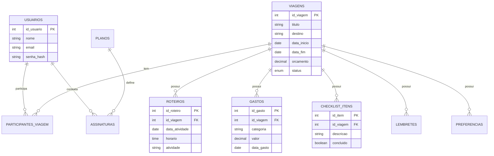

# TripEasy ✈

**Tudo da sua viagem em um só lugar.**

O TripEasy é uma plataforma digital criada para ajudar o usuário a organizar uma viagem de forma mais simples e centralizada. A proposta é reunir, em um único ambiente, informações e ferramentas que normalmente ficam espalhadas em diferentes aplicativos, anotações e sites.

> Projeto acadêmico desenvolvido em grupo.

---

## O problema e a proposta

Quando uma pessoa organiza uma viagem, as informações se espalham: o roteiro fica em um app, o orçamento numa planilha, os lembretes no WhatsApp e o checklist em papel. Isso gera retrabalho e o risco de esquecer algo importante.

O TripEasy funciona como um **hub único**: destino, datas, orçamento, roteiro, despesas, checklist e lembretes na mesma plataforma.

## Funcionalidades

**Usuário**
- Cadastro e login
- Gerenciar viagens (criar, visualizar, editar e excluir)
- Definir preferências de viagem
- Gerenciar o roteiro, com as atividades de cada dia
- Gerenciar despesas e acompanhar o orçamento
- Gerenciar o checklist de preparação
- Gerenciar lembretes

**Administrador (planejado)**
- Login
- Gerenciar destinos
- Visualizar relatórios

**Requisitos não funcionais**

| Requisito | Atributo de qualidade |
| --- | --- |
| Senha armazenada com algoritmo seguro | Segurança |
| Carregamento rápido | Performance |
| Interface responsiva | Usabilidade / Compatibilidade |
| Disponibilidade com manutenção programada | Confiabilidade |
| Módulos independentes | Manutenibilidade / Escalabilidade |


## Tecnologias

| Camada | Tecnologias |
| --- | --- |
| Backend | Java 21, Spring Boot 4, Spring Data JPA (Hibernate), Spring Security, Bean Validation, Maven |
| Banco de dados | MySQL |
| Frontend | HTML, CSS e JavaScript puro, com Vite como servidor de desenvolvimento |
| Autenticação | Sessão por cookie, com senhas criptografadas (BCrypt) |

## Estrutura do repositório

```
Trip-Easy-Project/
├── src/                          # Backend (Spring Boot)
│   └── main/java/br/com/tripeasy/
│       ├── controller/           # Rotas da API
│       ├── service/              # Regras de negócio
│       ├── repository/           # Acesso ao banco
│       ├── model/                # Entidades
│       ├── dto/                  # Objetos de entrada e saída
│       ├── config/               # Segurança
│       └── exception/            # Tratamento de erros
├── frontend/                     # Frontend (HTML, CSS e JS)
├── EXEMPLOS_JSON_DESPESAS.md     # Exemplos da API de despesas
├── pom.xml
└── mvnw / mvnw.cmd               # Maven Wrapper
```

## Como rodar o projeto

### Pré-requisitos

- [JDK 21](https://adoptium.net) (precisa ser o **JDK**, não só o JRE)
- [MySQL 8](https://dev.mysql.com/downloads/) rodando na porta 3306
- [Node.js 18 ou superior](https://nodejs.org)

### 1. Criar o banco de dados

Basta criar o banco vazio. As tabelas são criadas automaticamente pelo Hibernate na primeira execução.

```sql
CREATE DATABASE tripeasy;
```

### 2. Subir o backend

Defina a senha do MySQL em uma variável de ambiente (nunca coloque a senha no código) e rode:

```powershell
# Windows (PowerShell)
$env:DB_PASSWORD='sua_senha_do_mysql'
.\mvnw.cmd spring-boot:run
```

```bash
# Linux / macOS
export DB_PASSWORD='sua_senha_do_mysql'
./mvnw spring-boot:run
```

| Variável | Obrigatória | Padrão |
| --- | :---: | --- |
| `DB_USERNAME` | não | `root` |
| `DB_PASSWORD` | sim | — |

> Se o seu MySQL **não tem senha**, troque a linha no `src/main/resources/application.properties` por `spring.datasource.password=${DB_PASSWORD:}`.

O backend sobe em `http://localhost:8080`. Abrir `http://localhost:8080/api/viagens` no navegador e receber **403** é o resultado esperado: significa que a API está no ar e exigindo login.

### 3. Subir o frontend

Em **outro terminal**:

```bash
cd frontend
npm install
npm run dev
```

O app abre em `http://localhost:5173`. O Vite encaminha as chamadas `/api` para o backend, então não é preciso configurar CORS. Os **dois terminais ficam abertos** enquanto você usa o sistema.

## API

Todas as rotas, exceto cadastro e login, exigem usuário logado. Sem login, a API responde **403**. Cada usuário só acessa as próprias viagens.

| Área | Rotas |
| --- | --- |
| Usuário | `POST /api/usuarios/cadastro` · `POST /api/usuarios/login` · `POST /api/usuarios/logout` |
| Viagens | `GET /api/viagens` · `POST /api/viagens` · `GET`, `PUT` e `DELETE /api/viagens/{id}` |
| Roteiro | `GET` e `POST /api/viagens/{id}/atividades` · `GET /api/viagens/{id}/atividades/por-dia` · `PUT` e `DELETE /api/atividades/{id}` |
| Checklist | `GET` e `POST /api/viagens/{id}/checklist` · `PATCH /api/checklist/{id}/concluido` · `DELETE /api/checklist/{id}` |
| Despesas | `GET` e `POST /api/viagens/{id}/despesas` · `GET /api/viagens/{id}/despesas/resumo` · `PUT` e `DELETE /api/despesas/{id}` |
| Preferências | `GET` e `POST /api/preferencias` |

Regras de validação importantes:
- As datas de ida e de volta de uma viagem **não podem estar no passado**.
- A senha precisa ter de 6 a 72 caracteres.
- Categorias de despesa: `ALIMENTACAO`, `TRANSPORTE`, `HOSPEDAGEM`, `PASSEIOS` e `OUTROS`.

Exemplos completos de requisição e resposta de despesas: [`EXEMPLOS_JSON_DESPESAS.md`](EXEMPLOS_JSON_DESPESAS.md).

## Modelo de dados

O modelo abaixo é o **diagrama planejado pelo grupo**. O backend já implementa `usuarios`, `viagens`, `roteiros`, `checklist_itens`, `despesas` (que no diagrama aparece como `gastos`) e `preferencias`. As demais tabelas fazem parte das próximas etapas.



A estrutura é **relacional**: o destino de uma viagem fica só na tabela `viagens`, e as outras tabelas apenas referenciam o `id_viagem`. A tabela `participantes_viagem` é associativa, porque um usuário participa de várias viagens e uma viagem pode ter vários participantes.

## Rastreabilidade

Requisitos, casos de uso, classes e banco de dados formam uma cadeia. Exemplo:

> **Requisito:** criar, editar e excluir viagens → **Caso de uso:** Gerenciar Viagem → **Classe:** `Viagem` (`criar()`, `editar()`, `excluir()`) → **Tabela:** `viagens`

## Como contribuir (fluxo do grupo)

1. Atualize a `main`: `git checkout main` e `git pull origin main`.
2. Crie um branch para a sua tarefa: `git checkout -b nome-do-branch`.
3. Faça os commits e envie: `git push -u origin nome-do-branch`.
4. Abra um **Pull Request** para a `main` e peça revisão a alguém do grupo.

Não envie alterações direto para a `main`. Nunca envie senhas, arquivos `.env` ou as pastas `node_modules` e `target`.

## Equipe

- Ellen Cristina
- Daniele Soares
- Raylla Bianka
- Luis Gustavo
- Gabriel Gomes

**Orientador:** Vinicius Nepomuceno
